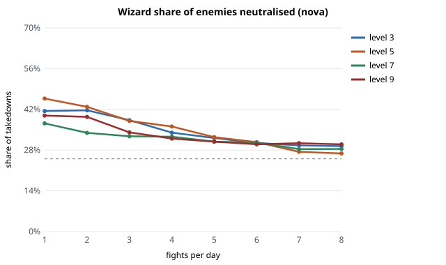
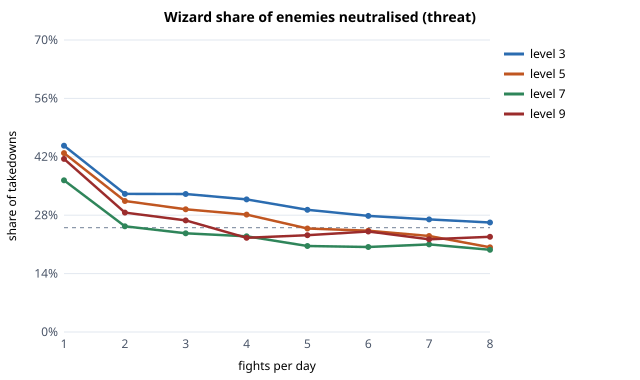
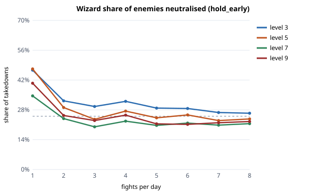
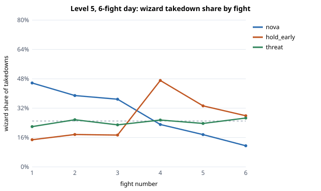
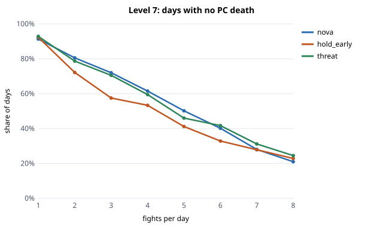

# Does attrition balance casters and martials in D&D 3.5? — Findings

A Monte Carlo test of one claim, using only SRD (open content) rules.

**The claim (owner's):** played as a dungeon crawl with attrition, 3.5 is balanced *in
aggregate, not per encounter*. At five or six fights a day casters must conserve, and the
key choice is in the early fights, when the wizard decides whether to spend spells or let
the fighter handle it. At one big fight a day the wizard spends everything and martials
look weak.

**Short answer.** The headline holds in this model, and so does "in aggregate, not per
encounter". Two of the mechanisms the claim names don't hold up:

1. **Holds:** the wizard's share of enemies neutralised falls steadily as the day gets
   longer, at every level and under every spending policy. At one fight a day the wizard
   neutralises 37–46% of enemies (an even split would be 25%). At 6–8 fights it's 27–31%
   for a wizard who spends freely, and 20–29% for one who conserves. The fighter's share
   rises to match.
2. **Holds:** the balance is an average across the day, not a property of each fight. A
   wizard who spends freely takes 46% of takedowns in fight 1 of a 6-fight day at 5th level
   and 11% in fight 6. The fighter carries the second half.
3. **Fails in part:** *conserving early doesn't pay.* Holding spells back in the early fights
   gives the same or **worse** party survival than spending freely at 7th and 9th level, and
   the wizard ends the day with 50–75% of their spell levels still unused. Spending by threat
   comes out a little ahead at 5th level and about even elsewhere. In this model the
   resource that runs out is the party's hit points and the cleric's healing, not the
   wizard's spells.
4. **Fails:** *"one big fight → the wizard spends everything" doesn't happen.* In a single
   fight the wizard runs out of rounds before running out of spells. That's true even in
   one fight worth a whole day's XP (EL+4): they end it with 17–81% of spell levels unused,
   and their takedown share is *lower* than in an ordinary single fight. What makes martials
   look weak at one fight a day is the opening round of area damage and control, not a dump
   of the whole spellbook.
5. **Against the claim, and it matters:** the evening-out depends on days hard enough to drain
   the party. With slightly easier fights (average EL one below party level), a free-spending
   wizard still takes 43% of takedowns over a 6-fight day at 5th level, with 91% survival.
   Attrition only balances the classes when it actually bites.

Everything below says how far to trust each of these, what the model leaves out, and how
sensitive the results are.

---

## What was modelled

- **Party:** human fighter, cleric, rogue, wizard at levels 3, 5, 7, 9. SRD base attack,
  saves, hit points (max at 1st, then average), iterative attacks, spells per day, bonus
  spells from ability scores, cleric domain slots, sneak attack, Weapon Focus and Weapon
  Specialization.
- **Monsters:** 14 SRD monsters, from orc (CR ½) to frost giant (CR 9), with SRD attacks, AC,
  touch AC, saves, HD and type. Undead immunities (mind-affecting, poison, sneak attack,
  crits) and troll regeneration are included.
- **Encounters:** an Encounter Level is rolled per fight as party level −1 / +0 / +1 / +2
  with weights 20/50/20/10%. Groups follow the SRD rule of thumb (two creatures of CR x =
  EL x+2, four = EL x+4).
- **Combat:** d20 initiative; natural 1/20; critical threat and confirmation; precision
  damage not multiplied; minimum 1 damage; dying at −1 to −9 with 10%/round stabilisation;
  death at −10; coup de grace against helpless foes (automatic critical, Fort DC 10 +
  damage or die).
- **Spells:**
  - Wizard: *magic missile, sleep, color spray, scorching ray, glitterdust, fireball,
    stinking cloud, hold person, ice storm, cone of cold, hold monster*.
  - Cleric: *cure light/moderate/serious/critical* (with spontaneous conversion),
    *spiritual weapon, hold person, searing light, flame strike*.
  - Control is modelled as SRD conditions: asleep, paralysed (a fresh save each round
    against *hold*), unconscious, stunned, nauseated (re-saving inside the cloud), blinded
    (50% miss chance, −2 AC, open to sneak attack).
- **Policies for both casters:**
  - `nova`: spend whenever a spell beats a mundane attack by 1.5×.
  - `hold_early`: no spells in the first half of the day unless there's an emergency (a PC
    down or under 25% HP, or the party under 50% HP), then spend freely.
  - `threat`: spend when the fight is above party level, there's an emergency, the fight is
    dragging, or it's the last fight; otherwise allow only 1st–2nd-level spells, and only if
    ahead of an even spending schedule.
  - All three policies heal the same way: in combat when a PC is under 30%, and between
    fights for anyone under 60%.
- **Measured per fight number and per day length (1–8 fights):**
  - damage share per class
  - kills, meaning killing blows
  - **takedowns**: a kill credited to whoever *disabled* a helpless foe if it was helpless
    when it died, otherwise to the killer. This is the main "enemies neutralised" metric.
  - enemy turns denied by conditions
  - days with no PC death, days completed, TPKs
  - wizard and cleric spell levels left at day's end, party HP left

600 simulated days per cell; seed 35. About 2 minutes to run the whole thing.

## Assumptions, stated before running

These were fixed before looking at results, not tuned toward them:

| Assumption | Value | Tested in sensitivity? |
|---|---|---|
| Ability scores | primary 16 (+1 at 4th and 8th), Con 14/12 | no |
| Magic gear | +0 at 3rd; +1 weapon/armor/cloak at 5th; +2 armor, ring +1, +2 casting stat at 7th; +2 weapon at 9th | no |
| AoE coverage | each foe caught with probability 0.5 (*flame strike*) to 0.8 (*fireball*) | yes (×0.6, ×1.25) |
| Who enemies attack | weights fighter 4 : cleric 2.5 : rogue 2 : wizard 1 | yes (equal) |
| Rogue flanking | 50% of attacks get sneak attack | yes (20%) |
| Wizard spells prepared | mixed blast and control | yes (blaster, controller) |
| Casters know the day's length | yes | yes (they assume 4) |
| Out-of-combat healing | cleric slots only | yes (wand of *cure light wounds*) |
| EL mix | −1/0/+1/+2 at 20/50/20/10% | yes (easier mix) |
| Round 1 | melee on both sides gets one attack (move + attack); casters act fully | no |
| No retreat, no resting early | the party fights every scheduled encounter or dies | no |

## Results

### 1. Day length: the wizard's share falls as the day gets longer





Share of takedowns. The dashed line is an even 25%.

| Level | 1 fight (nova) | 6 fights (nova) | 8 fights (nova) | 6 fights (threat) | 6 fights (hold early) |
|---|---|---|---|---|---|
| 3 | wiz 41% / ftr 28% | 30% / 33% | 29% / 33% | 28% / 35% | 29% / 35% |
| 5 | 46% / 29% | 31% / 37% | 27% / 39% | 24% / 40% | 26% / 38% |
| 7 | 37% / 37% | 31% / 41% | 28% / 43% | 20% / 50% | 22% / 50% |
| 9 | 40% / 28% | 30% / 36% | 30% / 36% | 24% / 39% | 21% / 43% |

Raw damage tells the same story with bigger numbers at 7th, where *fireball* hitting groups
of ogres and trolls dominates. The wizard's damage share there goes from 56% at one fight
to 44% at eight. Most of the change happens by fight 4 or 5 and then levels off.

Per-level charts: `charts/shares_level{3,5,7,9}.svg`.

### 2. In aggregate, not per encounter



Wizard share of takedowns by fight number in a 6-fight day at 5th level, with the spell
levels the wizard spent in that fight:

| Fight | 1 | 2 | 3 | 4 | 5 | 6 |
|---|---|---|---|---|---|---|
| nova | 46% (4.1) | 39% (3.8) | 37% (3.5) | 23% (3.0) | 18% (1.3) | 11% (0.4) |
| hold early | 15% (0.6) | 18% (1.0) | 17% (1.2) | 47% (3.8) | 33% (3.6) | 28% (3.0) |
| threat | 22% | 26% | 23% | 26% | 24% | 27% |

This is the claim's "balanced in aggregate, not per encounter", almost literally. The free
spender and the early hoarder both produce lopsided fights that average out. The day is
just front-loaded or back-loaded. **Spending by threat is the only policy that makes each
fight look balanced**, and it gets there by rationing.

### 3. Conserving early doesn't buy survival (against the mechanism)



Days with no PC death:

| Level, fights | nova | hold early | threat |
|---|---|---|---|
| 5, 6 | 59% | 59% | **68%** |
| 7, 3 | **72%** | 57% | 70% |
| 7, 6 | 40% | 33% | **42%** |
| 9, 3 | **45%** | 29% | 38% |
| 9, 6 | **17%** | 9% | 11% |

At the end of a 6-fight day the hoarding wizard still has 53% (7th) or 73% (9th) of their
spell levels unspent. The fights they sat out cost hit points and cure spells, and those
don't come back. Spending by threat is the best or close to it from 5th level up. It isn't
better at 3rd, where few spells means there's little to manage. **The claim's instinct, that
the wizard should let the fighter handle the early fights, is the weaker play here.** The
better play is to ration against the threat, not against the fight count.

### 4. The resource that runs out is hit points, not spells

At 9th level a free-spending wizard ends a 6–8-fight day with **41–44% of spell levels left**.
The party dies first: 17% survive a 6-fight day. At 3rd and 5th level, by contrast, the
nova wizard really is dry by fight 4 or 5 (2–6% left), and that's where the evening-out
comes from. So the claim's mechanism, casters forced to conserve because slots run out, is
real at low level. At high level in this model it's replaced by a different limit: the
cleric's healing and the party's HP. Part of this is the model being too hard on the party
(no buffs, no retreat; see the omissions below). Even so, it's a warning that "the wizard
must conserve" and "the day is long" aren't the same thing.

### 5. One big fight: the wizard doesn't spend everything

`results/big_fight.csv`: a single fight per day at EL +0, +2, +3 or +4 (+4 is about four
ordinary fights' XP).

| Level | EL+0: wiz share, slots left | EL+2 | EL+4 |
|---|---|---|---|
| 3 | 46%, 65% left | 34%, 33% | 21%, 17% |
| 5 | 44%, 79% | 34%, 55% | 22%, 46% |
| 7 | 38%, 82% | 26%, 71% | 33%, 75% |
| 9 | 41%, 84% | 39%, 77% | 27%, 81% |

The wizard gets one spell per round and fights last 2–5 rounds, so a single fight *can't*
use up a 9th-level spellbook. Spending ability is limited by actions per round, not by slots.
A huge single fight also tends to kill the party (L9 at EL+4: 1% survival), and the
fighter's share of takedowns *rises*. So "at one big fight a day martials look weak"
is true only for an ordinary-sized single fight, and the cause is the wizard's opening
burst of area damage and control.

### 6. Sensitivity

Wizard share of takedowns and survival, 5th and 9th level, 1 and 6 fights
(`results/sensitivity.csv`):

| Variant | L5, 1 fight (nova) | L5, 6 fights (nova / threat) | L9, 6 fights (nova / threat) |
|---|---|---|---|
| baseline | 46% | 31% / 24% (surv 59% / 60%) | 30% / 24% (surv 17% / 11%) |
| AoE coverage ×0.6 | 31% | 25% / 20% | 26% / 20% |
| AoE coverage ×1.25 | 51% | 31% / 25% | 33% / 25% |
| easier fights | 56% | **43% / 34% (surv 91% / 94%)** | **33% / 19% (66% / 53%)** |
| wand of CLW | 43% | 28% / 22% (surv 68% / 70%) | 27% / 21% |
| wizard attacked as often as anyone | 40% | 28% / 22% (surv 51% / 55%) | 28% / 18% |
| blaster spells | 46% | 30% / 23% | 27% / 19% |
| controller spells | 23% | 22% / 16% (surv 65% / 68%) | 18% / 16% |
| day length unknown (plans for 4) | 44% | 29% / 26% | 31% / 24% |
| rare flanking (20%) | 46% | 31% / 24% | 32% / 25% |

How to read this:

- **The direction (wizard share falls with day length) survives every variant.** How big the
  effect is depends most on how hard the day is and on AoE coverage, which stands in for
  positioning the model doesn't have.
- **Easier days undo most of the evening-out.** That's the strongest result against the claim.
- **A controller wizard earns fewer takedowns on paper but survives better.** Disabling a foe
  only counts as the wizard's takedown when the foe is helpless, so blinding, nausea and
  stunning are undercounted. The model can only partly see control (below).
- **If the wizard doesn't know how long the day is,** hoarding becomes costly: at 9th level,
  one fight with `hold_early`, survival falls from 80% to 67%, and the wizard neutralises
  only 18% of enemies. A DM who hides day length makes conservation riskier.

## What the model leaves out

- **Positioning, terrain, movement.** No grid. Area coverage is a flat probability, there's
  no friendly fire from *fireball* or *stinking cloud* (in a real game the fighter is often
  standing in it), no chokepoints, no flying, no ranged monsters, no reach.
- **Battlefield control, mostly.** Sleep, color spray, hold, glitterdust and stinking cloud are
  in. *Web, grease, solid fog, black tentacles, wall* spells, *slow, haste, invisibility,
  fly, dimension door* and summons are not. Control that splits encounters or prevents them
  entirely (walls, fog, flight) is the wizard's biggest lever in real play, and it's
  absent. **This model probably understates the wizard, most of all at 7th–9th.**
- **Buffs.** No *bless, prayer, bull's strength, haste, magic vestment, shield, mage armor,
  heroism*. This understates casters and also explains part of why the party dies so much.
- **Tactics and retreat.** The party never retreats, rests early, scouts, sets ambushes or
  uses the 15-minute workday. The DM never lets monsters flee or parley. Absolute survival
  numbers are therefore **not credible**. Read survival only as a comparison between
  policies.
- **Monster variety.** No spellcasting monsters, no energy drain effects (wights' drain is
  ignored), no poison, no fear, no damage reduction or spell resistance beyond what the
  SRD monsters listed here have. All melee brutes.
- **Item economy.** No scrolls, wands (except the CLW sensitivity), potions or consumables.
  Gear is a fixed assumption, not SRD wealth-by-level (that's in the DMG).
- **Rogue skills, the cleric turning undead, the fighter's feats beyond Weapon Focus and
  Specialization** (no Power Attack, Cleave, trip or Combat Reflexes).
- **Out-of-combat value.** The rogue's traps and scouting, the wizard's divinations and
  utility. The contribution metrics count combat only.
- **XP and leveling across days.**

## What this might mean for an AI DM pacing a day

- To make the martials matter, run **long days at full difficulty**. Easy long days don't
  balance the classes.
- Expect lopsided individual fights. That's what balance in aggregate means. Don't
  rebalance encounter by encounter.
- A smart caster ration should key on **threat, not fight count**. An AI playing or
  advising casters should spend on dangerous fights and hold back in easy ones, rather than
  "save for later".
- At high level, healing and HP drain faster than spells. A day that runs out of cure spells
  ends before the wizard's spellbook does.

## Reproduce

Windows: double-click `run_sim.bat` (needs Python 3.8+, no packages). It runs the tests, then
the experiments, and opens `charts/`. Anywhere else:

```bash
cd attrition-sim
python -m unittest discover -s tests
python run_experiments.py            # --days N, --seed S, --quick
```

Files: `sim/rules.py` (SRD mechanics), `sim/content.py` (party, monsters, encounters),
`sim/engine.py` (spells, policies, combat, day), `run_experiments.py` (grid, sensitivity,
charts), `results/*.csv`, `charts/*.svg`.
